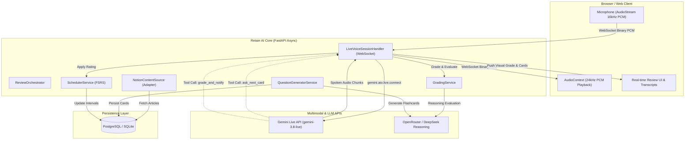

# Retain AI 🧠🎙️

> **An intelligent, real-time voice study partner that transforms technical reading into permanent knowledge using spaced repetition and multimodal LLMs.**

Retain AI syncs articles from your note-taking tools (such as Notion), extracts deep technical concepts, generates high-yield conceptual flashcards, and quizzes you out loud using bidirectional voice streaming. Powered by **Google Gemini Live**, **OpenRouter / DeepSeek reasoning**, and the **Free Spaced Repetition Scheduler (FSRS)** algorithm, Retain AI simulates an interactive, collegiate technical interview to maximize long-term retention.

---

## 🌟 Key Highlights & Engineering Features

- **Bidirectional Real-Time Voice Streaming**:
  Built on the official Google GenAI Live API (`gemini-3.8-live`). Streams 16-bit 16kHz PCM audio from your browser microphone and receives low-latency 24kHz synthesized speech back over a resilient WebSocket connection.

- **Agentic Function Calling**:
  The voice agent operates autonomously using dynamic tool calls:
  - `ask_next_card`: Fetches the next scheduled card when starting or transitioning.
  - `grade_and_notify`: The LLM itself decides when you've finished answering (or if you're stuck vs. asking for a hint), evaluating your spoken answer against reference material and updating your schedule in real-time.

- **Hybrid LLM Pipeline**:
  - **Gemini Live API**: Handles natural, interruption-friendly voice conversation with microsecond latencies.
  - **OpenRouter (DeepSeek reasoning `deepseek-v4.1-flash-1017`) / Gemini Flash**: Powers background technical question generation and deep answer grading with chain-of-thought reasoning and partial-credit evaluation.

- **FSRS Spaced Repetition Engine**:
  Replaces archaic Leitner/SM-2 algorithms with the modern **Free Spaced Repetition Scheduler (FSRS)**. Spoken evaluations (0–100) are mapped to cognitive ratings (`Again`, `Hard`, `Good`, `Easy`) to dynamically adjust memory stability, difficulty, and optimal review intervals.

- **Domain-Driven Design (DDD) & Clean Architecture**:
  - **Separation of Concerns**: Decouples read-only Content (`Article`) from mutable Review State (`ReviewCard`).
  - **Pluggable Adapter Pattern**: `ContentSource` interface abstracts sync targets. Notion integration includes incremental hashing/deduplication to avoid redundant fetches. Easily extensible to Obsidian, Readwise, or local Markdown.
  - **Dual Database Support**: Fully asynchronous SQLAlchemy 2.0 with automatic zero-configuration SQLite (`aiosqlite`) fallback for local development or PostgreSQL (`asyncpg`) for production.

---

## 🏗️ System Architecture



---

## 🔁 Complete Review Workflow

1. **Content Ingestion (`/api/sync`)**:
   Connects to your Notion database, filters previously synced pages, extracts clean markdown and metadata, and stores them as `Article` entities.
2. **QA Generation**:
   Articles are processed by `QuestionGeneratorService`. Using structured JSON schema enforcement and self-correcting retry loops, it synthesizes 3–5 targeted conceptual questions per article with reference explanations.
3. **Voice Review Session (`/ws/review`)**:
   Opening the web dashboard initializes a live WebSocket connection:
   - The agent calls `ask_next_card` to retrieve the top due card from FSRS.
   - The agent asks the question conversationally out loud.
   - You speak your answer naturally. If you hesitate, ask for a hint, or need clarification, the agent gently guides you without penalizing.
4. **Autonomous Evaluation (`grade_and_notify`)**:
   Once the agent detects you have provided your answer:
   - It invokes `grade_and_notify` with your transcribed response.
   - `GradingService` assesses conceptual accuracy, checks for key mechanisms, awards partial credit, and constructs spoken feedback.
   - `SchedulerService` calculates the updated stability, difficulty, and next review date.
   - The UI immediately renders visual scorecard feedback, and the agent verbally shares what you got right and what was missing.
5. **Next Card**:
   The agent transitions smoothly to the next due card until the queue is clear.

---

## 📂 Project Structure

```
retain_ai_python/
├── retain_ai/
│   ├── adapter/
│   │   ├── content_source.py          # Abstract ContentSource interface
│   │   ├── openrouter_client.py       # Async OpenRouter client with reasoning support
│   │   └── notion/                    # Notion API client and parser
│   ├── api/
│   │   └── routes.py                  # REST endpoints (/sync, /cards/due, /grade)
│   ├── domain/
│   │   ├── article.py                 # Core content domain model
│   │   ├── review_card.py             # FSRS card entity & review metrics
│   │   └── grade_result.py            # Structured grading contract
│   ├── repository/
│   │   ├── article_repository.py      # Async SQLAlchemy Article repository
│   │   └── review_card_repository.py  # Due card retrieval & scheduling queries
│   ├── service/
│   │   ├── question_generator_service.py # LLM QA generator with schema retry logic
│   │   ├── grading_service.py         # Multi-model evaluation (OpenRouter/Gemini)
│   │   ├── scheduler_service.py       # FSRS algorithm integration
│   │   └── review_orchestrator.py     # Coordinates queue management
│   ├── voice/
│   │   ├── gemini_live_client.py      # Gemini Live bidirectional audio client
│   │   └── live_voice_session_handler.py # Full-duplex WebSocket bridge & tool runner
│   ├── prompts/
│   │   └── voice-agent-prompt.txt     # Conversational guidelines & tool instructions
│   ├── static/                        # Frontend web app (Vanilla JS, AudioContext, CSS)
│   ├── config.py                      # Pydantic BaseSettings environment config
│   ├── database.py                    # Async engine & session management
│   └── main.py                        # FastAPI entry point & WebSocket route
├── tests/                             # Comprehensive test suite (async unit & mock tests)
├── .env.example                       # Environment template
├── .gitignore                         # Git exclusion rules
├── pytest.ini                         # Pytest configuration & pythonpath
├── requirements.txt                   # Production & dev dependencies
└── run.py                             # Fast launch script
```

---

## 🚀 Getting Started

### Prerequisites

- **Python 3.11+** (tested on Python 3.13)
- **Google Gemini API Key** (with access to `gemini-3.8-live`)
- *(Optional)* **OpenRouter API Key** (for DeepSeek reasoning models)
- *(Optional)* **Notion Integration Token** (for syncing Notion databases)

### 1. Installation

```bash
# Clone the repository
git clone https://github.com/your-username/retain-ai.git
cd retain-ai

# Create and activate a virtual environment
python3 -m venv .venv
source .venv/bin/activate

# Install dependencies
pip install -r requirements.txt
```

### 2. Environment Configuration

Copy `.env.example` to `.env`:

```bash
cp .env.example .env
```

Open `.env` and provide your credentials:

```ini
# Realtime Voice (Required)
GEMINI_API_KEY=your_gemini_api_key_here

# OpenRouter Reasoning (Optional, falls back to Gemini Flash)
OPENROUTER_API_KEY=your_openrouter_api_key_here
OPENROUTER_MODEL=deepseek/deepseek-v4.1-flash-1017

# Notion Sync (Optional)
NOTION_API_TOKEN=your_notion_token
NOTION_DATASOURCE_ID=your_notion_database_id

# Database (Optional - defaults to local SQLite retain_ai.db if empty)
DB_HOST=
```

### 3. Running the Server

Launch via the runner:
```bash
python run.py
```
Or directly with Uvicorn:
```bash
uvicorn retain_ai.main:app --host 0.0.0.0 --port 8080 --reload
```

Open your browser at **`http://localhost:8080`**, click **"Start Voice Review"**, grant microphone access, and begin your interactive voice review session!

---

## 🧪 Testing

The test suite validates repository operations, Notion parsing, OpenRouter/Gemini mock interactions, schema error retries, and agent tool execution.

```bash
# Run all tests
pytest -v
```

All 11 unit & integration tests run in parallel with `pytest-asyncio`.

---

## 🛡️ Design Decisions & Trade-offs

1. **Why Gemini Live instead of standard STT + LLM + TTS?**
   Traditional voice pipelines stitch together three distinct APIs (Speech-to-Text -> Text LLM -> Text-to-Speech), introducing 2–4 seconds of latency and losing prosody, tone, and inflection. Gemini Live's unified multimodal model enables immediate conversational turn-taking (< 500ms audio-to-audio latency) and allows the user to interrupt naturally.

2. **Why FSRS instead of Anki's SM-2?**
   The Free Spaced Repetition Scheduler models memory decay via two independent variables: **Stability** (how well the memory is consolidated) and **Difficulty** (inherent complexity of the concept). It outperforms SM-2 by minimizing unnecessary reviews of well-retained material while prioritizing genuinely difficult items.

3. **Why Agentic Function Calling for Grading?**
   Earlier implementations graded immediately on raw text frames or required heuristic silence detection. Empowering Gemini to invoke `grade_and_notify` ensures that conversational turns (asking for hints, clarifying the question, thinking out loud) are handled conversationally without prematurely marking an answer wrong.

---

## 📄 License

MIT License. Designed with focus on high engineering standards, clean architecture, and cognitive science principles.
